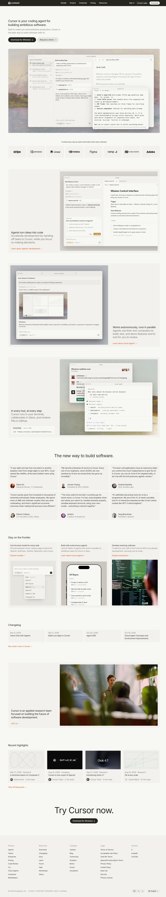
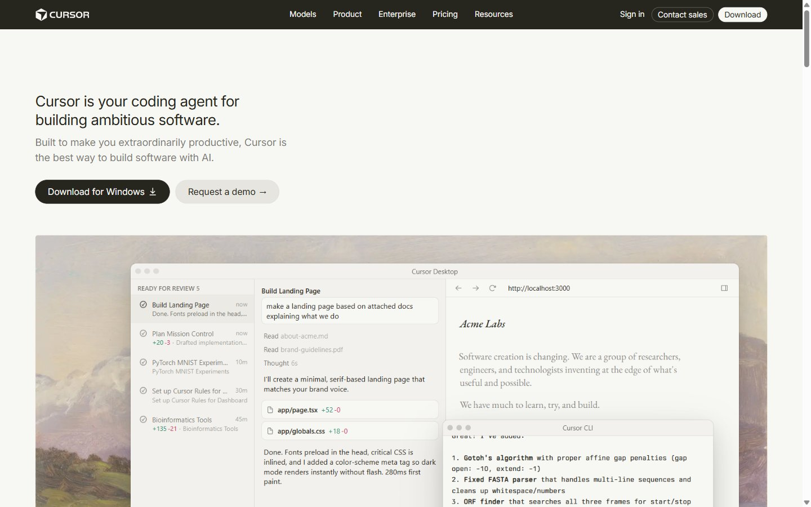
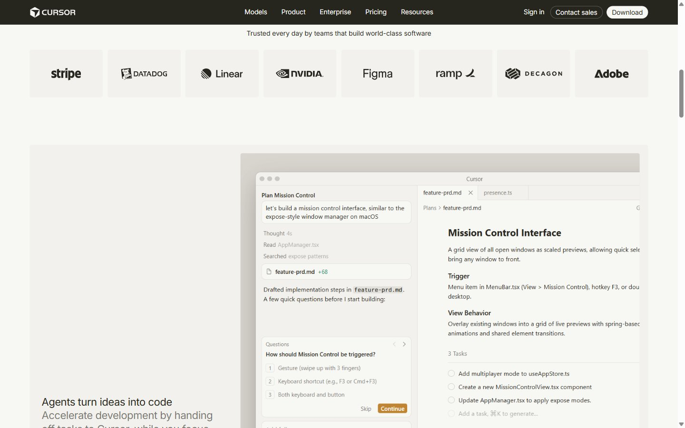
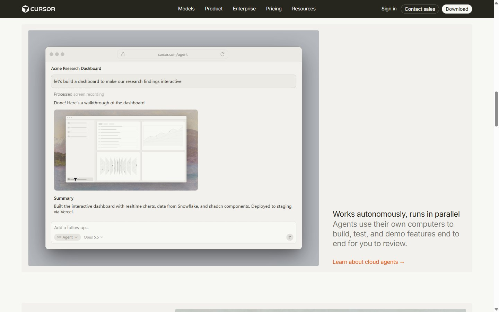
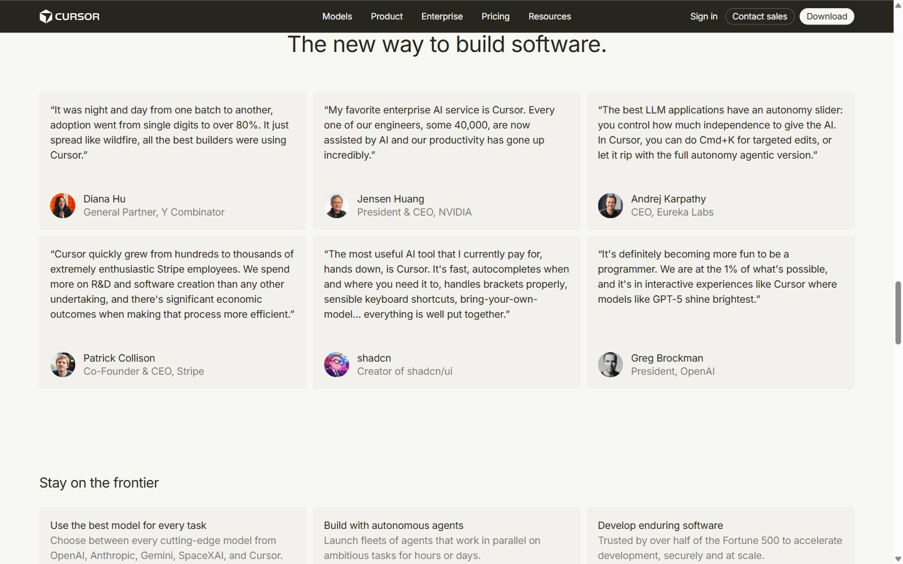
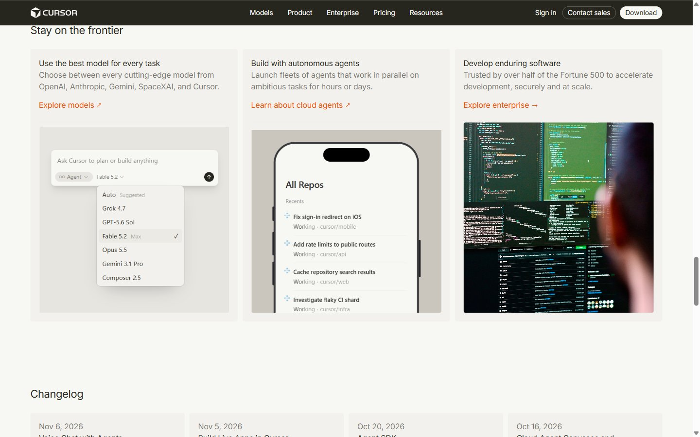
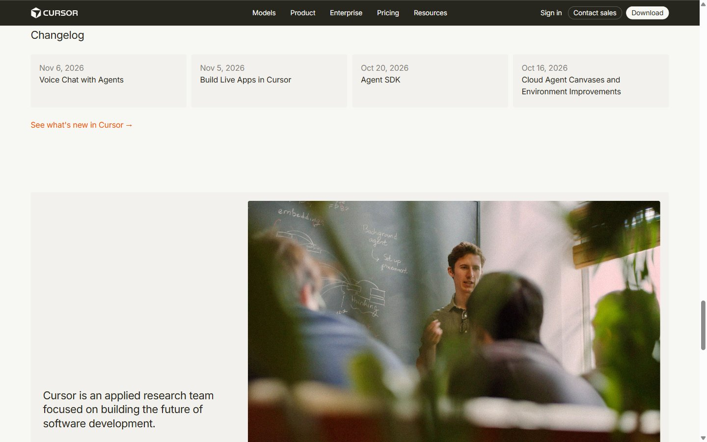
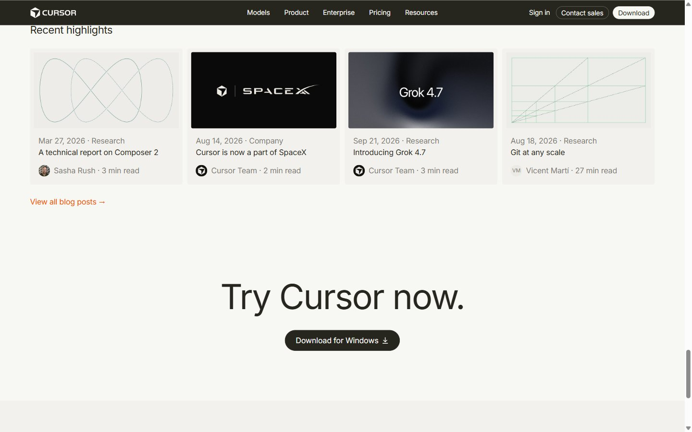
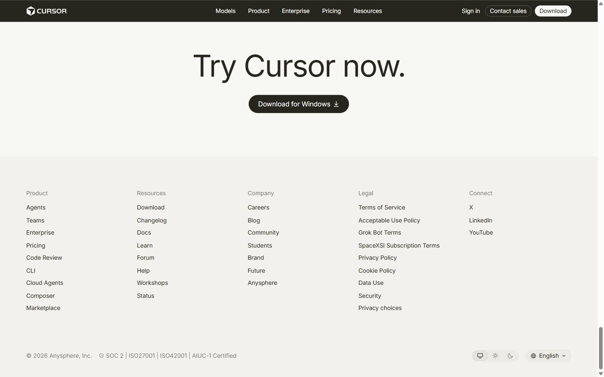

# Dev Tool Landing Page: Cursor (HTML & CSS)

This is a desktop-first recreation of the [cursor.com](https://cursor.com) landing page, built with **plain HTML and CSS only** (no JavaScript, no Tailwind, no animations).

- **Repository:** https://github.com/JaydeepKanzariya/cursor-landing-page
- **Live demo:** https://jaydeepkanzariya.github.io/cursor-landing-page/



## Sections recreated

| # | Assignment section | What it maps to on cursor.com |
|---|--------------------|-------------------------------|
| 1 | Top navigation bar | **Dark** bar (`#26251e`) with the light Cursor logo, Models / Product / Enterprise / Pricing / Resources, Sign in, *Contact sales* and a light *Download* pill button |
| 2 | Hero | Headline "Cursor is your coding agent for building ambitious software.", a short description (Cursor's tagline), two CTAs, and a large product screenshot over the painted wallpaper |
| 3 | Trusted by / logos | "Trusted every day by…" with 8 logo tiles (Stripe, Datadog, Linear, NVIDIA, Figma, Ramp, Decagon, Adobe) |
| 4 | Feature sections | 3 two-column blocks (text + image) with alternating image/text sides: *Agents turn ideas into code*, *Works autonomously, runs in parallel*, *In every tool, at every step* |
| 5 | Feature cards | "Stay on the frontier": section title + 3-card grid |
| 6 | Testimonials | "The new way to build software.": 6 quote cards with avatar, name and role |
| 7 | Use cases / stories | "Recent highlights": 4 story cards, each with a cover image (the post's own share image from cursor.com/blog), date, category, title and author |
| 8 | Changelog | 4 dated update cards + "See what's new in Cursor →" |
| 9 | Team / about | Large team photo + "Cursor is an applied research team…" + *Join us →* |
| 10 | Final CTA | "Try Cursor now." + *Download for Windows* button |
| 11 | Footer | 5 link columns (Product, Resources, Company, Legal, Connect), copyright, certifications, theme and language pills |

Sections follow the same order as the live site.

## Fonts

| Use | Original (cursor.com) | Used here |
|-----|----------------------|-----------|
| UI / headings / body | **CursorGothic** (proprietary) | `"CursorGothic", "Inter", system-ui, …`. If CursorGothic isn't installed, **Inter** (Google Fonts) is used, with tightened letter-spacing to match CursorGothic's width |
| Code | Berkeley Mono | `"Berkeley Mono", "JetBrains Mono", ui-monospace, …` |

Type scale taken from the live site's computed styles:

- Hero `h1`: 26px / 32.5px
- Feature titles: 22px / 28.6px
- Testimonials title: 36px
- Final CTA: 72px / 79.2px
- Body and cards: 16px / 24px
- Nav and footer: 14px

All text is weight 400, matching the original.

## Colors

| Token | Hex | Used for |
|-------|-----|----------|
| `--bg` | `#f7f7f4` | Page background |
| `--text` | `#26251e` | Primary text, dark buttons |
| `--text-sec` | `rgba(38,37,30,.6)` | Secondary text, dates, roles |
| `--card` | `#f2f1ed` | Cards, logo tiles, footer |
| `--card-2` | `#ebeae5` | Image placeholders, pills |
| `--btn-light` | `#e6e5e0` | "Request a demo" button |
| `--accent` | `#f54e00` | Orange text links ("Learn more →") |
| `--border` | `rgba(38,37,30,.1)` | Hairline borders |

The three core brand colors are confirmed against Cursor's [Brandfetch profile](https://brandfetch.com/cursor.com) (the brand-assets link in the brief):

- `#F54E00`: International Orange (accent)
- `#F7F7F4`: Cararra (background)
- `#26251E`: Rangitoto (text)

Brandfetch doesn't list a typeface for Cursor, so the font comes from cursor.com's own CSS.

> Note: the assignment brief asks for a dark navigation bar, so the navbar uses Cursor's brand dark color (`#26251e`) with light text. The rest of the page follows the live cursor.com, which uses a light, warm off-white theme.

## Layout notes

- Fixed 1300px content container, built for a 1440px-wide desktop viewport. It is not responsive, as the brief allows.
- 4px card radius, 10px grid gaps, 17.5px card padding. These match the original's measured values.
- CSS Grid is used for the nav, logo strip, feature blocks, card grids and footer. Flexbox is used inside components.
- Semantic HTML: `header`, `nav`, `main`, `section` with `aria-labelledby`, `article`, `figure`/`figcaption`, `blockquote`, `time datetime`, `footer`, plus a skip link and alt text on every image.

## Assets

- `assets/logos/`: SVG logos (Cursor wordmark and the 8 customer logos) taken from cursor.com. The Cursor wordmark is the same official mark Brandfetch provides.
- `assets/images/story-*.jpg`: blog cover images from cursor.com/blog. The "Git at any scale" cover is an animated GIF on the site; only its first frame is used, to respect the no-animations rule.
- `assets/images/`: the team and enterprise photos and testimonial avatars from cursor.com. The product UI images (hero, feature demos, model picker, mobile agents) are static captures of the live site's interactive demos, because this version can't use JavaScript.

All brand assets belong to Cursor / Anysphere, Inc. and are used here only for this educational exercise.

## Project structure

```
cursor-landing-page/
├── index.html
├── styles.css
├── assets/
│   ├── favicon.png
│   ├── images/
│   └── logos/
└── screenshots/
```

## Run locally

Open `index.html` in a browser. No build step is needed.

## Screenshots

All taken at a 1440px-wide desktop viewport.

**1. Navigation and hero**



**2. Trusted-by logos and first feature block**



**3. Feature block with the image on the left (alternating layout)**



**4. Testimonials**



**5. Feature cards: "Stay on the frontier"**



**6. Changelog and team / about**



**7. Recent highlights (story cards) and final call to action**



**8. Footer**


